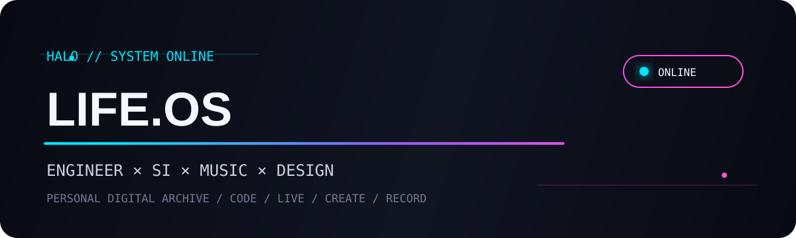

 

コード、音楽、日々の記録をまとめる個人アーカイブ。

 

---

## // EXPLORE

<table>
<tr>
<td width="50%" valign="top">

### 💻 ENGINEERING
IT技術関連

[→ Explore Engineering](./engineering-archive/) 
[→ Engineer Profile / プロファイル](./engineering-archive/profile.md)

</td>
<td width="50%" valign="top">

### 🎤 LIVE
イベント関連

[→ Explore Live Archive](./live-archive/) 
[→ History / 予定・履歴](./live-archive/encore-log.md)

</td>
</tr>

<tr>
<td>

### 🎧 MUSIC
音楽関連

[→ Explore Music Archive](./music-archive/)

</td>
<td>

### 🎨 CREATIVE
創作関連

[→ Explore Creative Archive](./creative-archive/)

</td>
</tr>

<tr>
<td>

### 📓 DAILY
記録関連

[→ Explore Daily Log](./daily-log/)

</td>
<td width="50%" valign="top">

### 📈 INVESTMENT
株式投資関連

[→ Explore Investment](./investment-archive/)

</td>
</tr>
</table>

---

## // TYPING

- Keyboard: REALFORCE R3S（有線 / フル / 45g / 英語配列 / ブラック / R3SB11）
- Record: [monkeytype](https://monkeytype.com/profile/haloyukka)

---

## // LINKS

| Service | Link |
|---|---|
| GitHub | [@haloyukka](https://github.com/haloyukka) |
| monkeytype | [haloyukka](https://monkeytype.com/profile/haloyukka) |
| X | [@halohalo_dtd](https://x.com/halohalo_dtd) |
| X | [@halohalo_6e6e](https://x.com/halohalo_6e6e) |
| X | [@halohalo_log](https://x.com/halohalo_log) |
| X | [@halohalo_lab](https://x.com/halohalo_lab) |

---

`HALO / LIFE.OS — personal digital archive`

